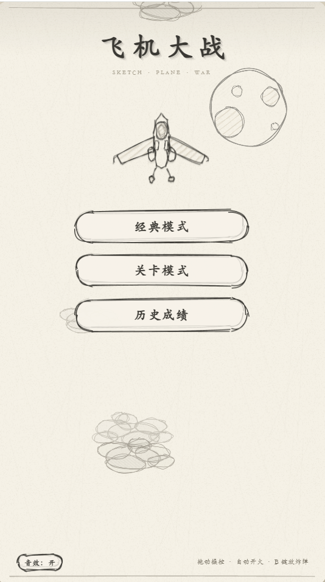

# 飞机大战 · 手绘线稿版

一个用**原生 Canvas 2D** 写的竖屏飞行射击游戏。所有美术——飞机、Boss、子弹、云、月亮、按钮边框——都由 **rough.js** 在运行时程序化生成，没有任何图片素材，整体是"铅笔描在纸上"的线稿风。

支持鼠标 / 键盘 / 手机手指触摸；包含经典模式与 12 关关卡模式（每关一个 Boss），进度与成绩存在 `localStorage`。



## 快速开始

> **必须通过本地服务器打开，不能双击 `index.html`。**
> 页面用的是 ES Module，`file://` 协议下浏览器会以 CORS 为由拒绝加载 `js/main.js`，双击只会看到白屏提示。

三种启动方式，任选其一：

```bash
# 1) 项目自带的零依赖服务器（推荐）
node server.mjs            # 然后打开 http://localhost:5173/

# 2) Python 自带静态服务器
python -m http.server 5173

# 3) Windows 直接双击
start.cmd                  # 自动选 node 或 python，起服务并打开浏览器
```

端口默认 `5173`，可用环境变量 `PORT` 覆盖（`PORT=8080 node server.mjs`）。

## 操作方式

| 操作 | 桌面 | 手机 |
| --- | --- | --- |
| 移动 | 鼠标移动，或 `WASD` / 方向键 | 手指按住屏幕拖动（机身会浮在指尖上方，不被手指挡住） |
| 开火 | 自动开火，无需按键 | 同左 |
| 炸弹 | `B` 或 `空格` | 点右下角"炸弹"按钮 |
| 暂停 | `P` 或 `Esc` | 点右下角"暂停"按钮 |

道具：`P` 火力升级（最高 4 级）、`B` 补一颗炸弹、`S` 护盾。开局 3 条命、2 颗炸弹；撞机/中弹会掉命，短暂无敌后重生。

## 12 个关卡

| # | 关卡 | Boss | HP |
| --- | --- | --- | --- |
| 01 | 晨雾起飞 | 晨雾巡逻舰 | 300 |
| 02 | 云上哨所 | 云上哨戒机 | 340 |
| 03 | 铁皮峡谷 | 峡谷装甲艇 | 390 |
| 04 | 逆风航线 | 双联逆风机 | 430 |
| 05 | 双塔空域 | 双塔守门人 | 470 |
| 06 | 墨色雷区 | 雷区清扫舰 | 520 |
| 07 | 断线高空 | 断线截击机 | 560 |
| 08 | 折翼之地 | 折翼要塞 | 600 |
| 09 | 风暴眼 | 风暴之眼 | 650 |
| 10 | 纸鸢废墟 | 纸鸢母舰 | 700 |
| 11 | 无声之境 | 无声双影 | 740 |
| 12 | 终章·墨之要塞 | 墨之要塞 | 860 |

每关由若干波敌机（侦察机 / 战斗机 / 轰炸机 / 精英机）铺垫，清完波次后 Boss 入场；击落 Boss 结算通关奖励并解锁下一关。

## 目录结构

```
index.html            页面骨架：canvas、UI 层、五个界面、HUD
server.mjs            零依赖静态服务器（node:http，带 MIME 与 no-cache）
start.cmd             Windows 一键启动脚本
css/
  base.css            设计变量（--u 缩放单位、墨色、纸色、字体）、reset、通用胶囊按钮
  layout.css          9:16 舞台自适应、canvas 与 UI 层的叠放
  menu.css            主菜单标题、按钮、页脚
  hud.css             顶部三栏 HUD、Boss 血条、炸弹/暂停按钮
  dialog.css          结算 / 暂停弹窗、遮罩、toast
  levels.css          关卡选择：标题栏 + 两列卡片网格
  records.css         历史成绩：经典前五 + 各关最佳
js/
  main.js             装配入口
  core/               config 常量、Loop 固定步长主循环、Input、Collision、Pool 对象池、Storage 存档、Audio 合成音效、Game 状态机
  art/                sketch 画笔封装、sprites 全部精灵、background 云/月/纸纹、effects 爆炸粒子
  entities/           Player、Enemy、Boss、Bullet、PowerUp
  systems/            Levels 关卡波次表、Spawner 经典/关卡刷怪器
  ui/                 router 界面路由、menu/levels/records/result/hud/pause 各界面、sketch-ui 把 DOM 按钮画成手绘边框、app 组装
  vendor/             rough.esm.js（rough.js 4.6.6，MIT，本地化避免外网依赖）
```

## 几个实现要点

- **逻辑分辨率固定 540 × 960**（9:16），Canvas 按 DPR 放大，CSS 用 `--u = 容器宽 / 540` 作为缩放单位，一套尺寸同时适配电脑和手机。
- **固定步长 60 Hz** 主循环（`Loop.js`），渲染补插值；单帧异常只记一次日志，不会让整个循环停摆。
- **rough.js 只跑一次**：所有精灵在启动时预渲染进离屏 canvas，之后每帧只是 `drawImage`；DOM 按钮的手绘边框同样预渲染成 PNG 背景，靠 `ResizeObserver` 在尺寸变化时重画。
- **音效零素材**：全部由 WebAudio 振荡器合成（射击、爆炸、拾取、UI），首次点击/按键时解锁音频上下文。
- **存档**：`localStorage` 键 `sketch-plane-war:save:v1`，读写都包了容错，存档损坏会自动回默认值。

## 提交规范

仓库使用 [Conventional Commits](https://www.conventionalcommits.org/)：

```
feat:      新功能
fix:       修 bug
style:     样式 / 排版调整（不影响逻辑）
refactor:  重构
docs:      文档
chore:     杂项（脚本、配置）
perf:      性能优化
```

示例：`feat(levels): 增加第 12 关与墨之要塞 Boss`

## 已知限制

- 必须起本地服务器（见开头说明），纯双击打开不工作。
- 音效依赖 WebAudio，需要用户首次交互后才响。
- 关卡数据写在 `js/systems/Levels.js`，目前没有关卡编辑器；调参改这个文件重启即可。
- 触屏操控是"拖动跟随"，不是虚拟摇杆；小屏上 HUD 字号会偏小。
